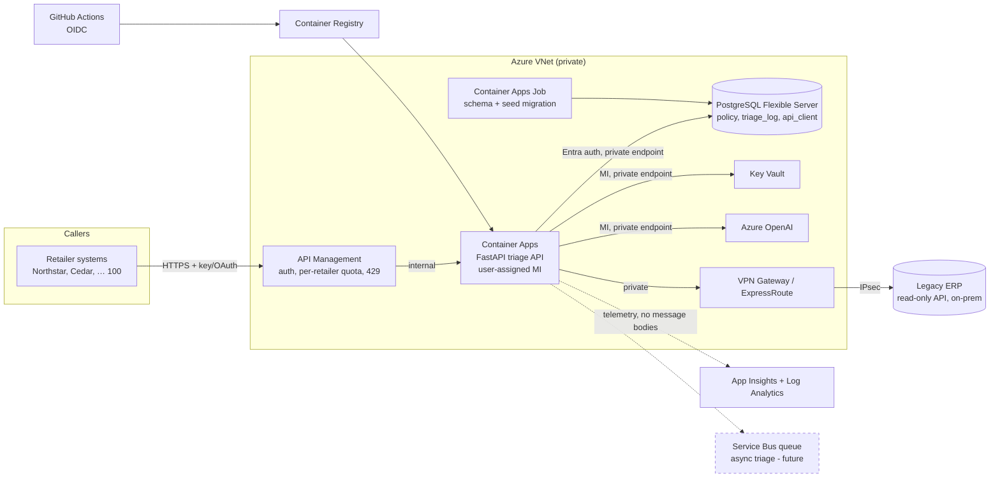

# Azure implementation plan

No Azure resources were provisioned for this submission. Everything here is a plan; the
config in [`infra/`](../infra/) is illustrative and **untested**, and placeholders are marked `<…>`.

## Assumptions

Given: 2 → 100 retailers, 10,000 tickets/day, bursts of 20 req/s, an external model provider
with timeouts and rate limits, an on-prem legacy ERP, sensitive messages, and a small team.

Added:

- A single region (e.g. UK South / Central India) with zone-redundant data services. DR uses
  geo-backups, not active-active.
- The ERP sits in a corporate data centre and exposes a **read-only HTTP endpoint or read
  replica** reachable over private connectivity. If only a nightly flat file exists, see the
  alternative below.
- Callers are retailer back-office systems (server-to-server), not browsers.
- Azure OpenAI is the model provider. A non-Azure provider changes only the credential path,
  which is covered below.
- Tokens per triage: ~800 prompt + ~120 completion ≈ **1k tokens per call**.

## Architecture

Retailer isolation is enforced at four points:

1. APIM maps the credential to a retailer, and the app re-derives the retailer from the key. Today that is a constant-time compare against a static map; the plan is a salted-hash lookup in `api_client`.
2. Every SQL query is filtered by `retailer`. A future addition is Postgres **row-level
   security** keyed on a per-session `app.retailer` setting, as defence in depth.
3. The ERP adapter discards other-retailer records.
4. The output guardrail rejects other-retailer content.

| Service | Purpose | Why it fits | Day one? |
| --- | --- | --- | --- |
| **Azure Container Apps** (Consumption + dedicated workload profile optional) | Runs the FastAPI container | Scale to N on HTTP concurrency (KEDA), revisions with traffic splitting for rollback, VNet integration, managed identity. No Kubernetes to operate, which suits a small team. | Yes |
| **Azure Database for PostgreSQL Flexible Server** | Policy store, audit log, API-client table | The code already uses portable SQLAlchemy Core. Entra ID auth for managed identity, built-in PgBouncer, zone-redundant HA, PITR. Cheaper burstable tier for day one. | Yes (Burstable B2s, HA later) |
| **Key Vault** (RBAC mode) | API-key pepper/hashes, ERP credential, non-Azure model keys | Versioned secrets, rotation, audit logs | Yes |
| **API Management** (Basic v2 / Standard v2) | Caller auth, per-retailer rate limits and quotas, 429 + `Retry-After` | Onboarding 100 retailers is products and subscriptions, not code. It protects shared model quota from one noisy tenant. | Yes (could defer until retailer #3, with app-level keys only) |
| **Azure OpenAI** (private endpoint) | Drafting | Keyless access through managed identity, regional data residency, quota management | Yes |
| **VPN Gateway** (S2S) → ExpressRoute later | Private path to the on-prem ERP | No public ERP exposure. ExpressRoute only if volume or latency requires it. | Yes (VPN) |
| **Container Registry**, **App Insights / Log Analytics** | Images, telemetry | Standard | Yes |
| **Service Bus** | Async triage at sustained overload | Decouples bursts from model quota | Future |
| **Front Door + WAF** | Global edge, WAF | Only needed if callers become public or browser-facing | Future |

**Alternative considered: ERP via file drop or replication instead of live lookup.** If the ERP
can only export the flat file, an Azure Data Factory or Functions job would land it in Blob and
upsert it into an `erp_order` table in Postgres. The adapter then becomes a DB query, and it
avoids VPN latency and ERP connection limits. The cost is **staleness**: a same-day delivery or
status change is missed. A stale record would have to be marked `as_of` and treated as
incomplete for time-sensitive facts. I prefer a live read-only lookup because the ERP is the
system of record. The adapter interface (`ErpAdapter`) makes either option a single-class swap.

## Identity, secrets and access

| Identity | Accesses | Permission | Scope |
| --- | --- | --- | --- |
| Retailer caller | APIM | APIM subscription key per retailer on day one. For 100 retailers: Entra ID client-credentials (OAuth2), with an APIM `validate-jwt` policy checking `aud` and the `retailer` claim. | One product/subscription per retailer |
| APIM → app | Container App internal ingress | APIM's managed identity gets a token for the app's Entra app registration. The app validates `aud`/`iss` (Container Apps built-in auth). | App only |
| `id-triage-api` (user-assigned MI) | Key Vault `kv-triage-prod` | **Key Vault Secrets User** (read secret values, no list of other vaults, no write) | That vault only |
| `id-triage-api` | PostgreSQL | Entra-authenticated DB role `triage_app`: `SELECT` on `policy`, `api_client`; `INSERT` on `triage_log`. **No** UPDATE/DELETE/DDL. | Database `triage` |
| `id-triage-api` | Azure OpenAI | **Cognitive Services OpenAI User** (inference only, no key listing, no deployments) | That AOAI account |
| `id-triage-api` | ACR | **AcrPull** | That registry |
| `id-triage-api` | ERP | No Azure RBAC applies. A service-account credential is stored as Key Vault secret `erp-api-credential` and network-restricted to the VPN subnet. | ERP read-only endpoints |
| `id-triage-migrate` (MI for the migration job) | PostgreSQL | DB role `triage_owner` (DDL, policy seed upsert) | Database `triage`; used only by the deploy job |
| `gh-triage-deploy` (Entra app, **GitHub OIDC federated credential**, no secret) | ACR, Container Apps, migration job | **AcrPush** on ACR; **Container Apps Contributor** on `rg-triage-prod`; start rights on the job. Federated subject is restricted to `repo:<org>/<repo>:environment:production`. | Resource group |
| On-call engineers | Logs, app | Log Analytics Reader (resource-context); no Key Vault secret read; PIM just-in-time elevation for prod changes | Workspace / RG |

- **Caller keys.** Only salted SHA-256 hashes are stored (`api_client.key_hash`, retailer, status,
  expires_at). The pepper lives in Key Vault. Rotation issues a second key, lets both work during
  overlap, then revokes the old one. This is also an APIM primary/secondary key swap.
- **External provider key** (if not Azure OpenAI): Key Vault secret with two versions
  (primary/secondary), referenced by the Container App as a Key Vault secret reference. Rotation:
  add the new key in the provider console → new secret version → restart the revision (or let the
  app refresh every 15 min) → revoke the old key. A Key Vault near-expiry event triggers an
  Event Grid alert.
- **Logs.** The app never logs message bodies or keys (the audit design already excludes them).
  App Insights uses sampling, and IP masking stays on. Log Analytics retention is 30 days
  interactive, then archive for 90 days. Access is via workspace RBAC. Key Vault and PostgreSQL
  diagnostic logs flow to the same workspace for access auditing.

## Deployment and rollback

The path from merged code to a release (illustrative workflow in
[`infra/deploy.workflow.example.yml`](../infra/deploy.workflow.example.yml)):

1. **PR checks:** `pytest`, `python -m eval.run_eval` (fake provider; fail if any acceptance case
   regresses), gitleaks, `pip-audit`, Bicep `what-if` on infra changes.
2. **Build** on merge to `main`: image `acr/triage:<git-sha>`, plus an SBOM and Trivy scan. Push
   with OIDC-federated login, so no stored Azure secret.
3. **Migrate:** run the Container Apps Job `triage-migrate` with the new image. It applies
   migrations (Alembic in production; this repo's idempotent `init_db` is the stand-in) and
   upserts `data/policies.json`. Migrations follow **expand → contract**, so the previous
   revision still works against the new schema and rollback never needs a DB downgrade.
   Policy text changes are data: versioned in git, reviewed, and gated by the rules/text
   consistency test.
4. **Deploy** a new Container Apps revision at **0% traffic**. Config comes from env vars, and
   secrets come as Key Vault references resolved by the managed identity.
5. **Verify:** `/health` on the revision URL must show `policy_store.ok` and `erp.ok`. Smoke tests
   with a dedicated *smoke* retailer key cover: one `policy_supported`, one `needs_information`,
   one `-TIMEOUT` fallback, and a cross-retailer probe that must return not-found.
6. **Release gate:** GitHub environment `production` with required reviewer. Then a traffic shift
   of 10% → watch for 15 min (5xx, p95 latency, fallback rate, ERP timeout rate against the
   previous revision) → 100%.
7. **Rollback:** `az containerapp ingress traffic set --revision-weight <previous>=100` moves
   traffic back instantly. The previous revision stays active for 24 h. A bad policy seed is
   rolled back by re-running the migration job with the previous image tag.

**Validating with Azure access:** run `az bicep build` and `az deployment group what-if` in a
sandbox RG. Deploy there and confirm managed-identity access to each resource, plus a negative
test proving a missing role fails. Then run the smoke suite. Finally, use Azure Load Testing at
20 req/s against a model stub with an 8 s injected delay to confirm the concurrency numbers below.

## Scaling and provider limits

- **In flight:** by Little's law, 20 req/s × ~8.5 s (model 8 s + ERP + DB) ≈ **170 concurrent
  requests**. With one retry on a fraction of calls, plan for ~200.
- **App concurrency:** FastAPI is async and the model call is non-blocking I/O, so one replica
  can hold many waiting requests. Blocking DB and ERP calls run in the default thread pool
  (about 32 threads), so that pool, plus memory, is the real per-replica limit. Production would
  move to an async DB driver and an async ERP client. Container
  Apps HTTP scale rule: `concurrentRequests: 40`, min 2 replicas (zone spread), max 10. Bursts
  run on ~5 replicas, and scale-out takes tens of seconds, so min replicas absorb the first wave.
- **ERP:** the production adapter should be async (`httpx` with a connection pool) with a
  **per-replica cap** (e.g. 8 connections × 10 replicas = 80 max), sized below the ERP's limit,
  plus a circuit breaker. When the breaker is open, requests take the ERP fallback immediately
  instead of piling up timeouts. ERP timeout: 2 s.
- **Model quota:** a 20 req/s burst × 1k tokens ≈ **1.2 M tokens/min**. Daily volume is
  10 k × 1k = 10 M tokens, or about 7 k TPM on average. The burst is far above the average, so
  options are:
  - a higher TPM quota or a provisioned-throughput deployment;
  - two regional deployments behind APIM's load-balanced backend pool;
  - an app-side token-bucket limiter.
- **When over limit:** no retry storms. Use at most one retry. A `Retry-After` of 2 s or less
  is honoured; anything longer goes straight to the documented fallback. All of this stays
  inside the 20 s `REQUEST_BUDGET_S`, and the code already implements it.
- **Cost-saving change:** skip the model call for outcomes whose reply is the fixed human-review
  acknowledgement. The current code calls it for every non-fallback outcome.
- **Timeouts:** model 8 s per attempt, ERP 2 s, overall request 20 s, APIM backend timeout 25 s,
  and callers should use ≥ 30 s.
- **Queueing vs rejection:**
  - Per-retailer APIM rate limits reject excess with **429 + `Retry-After`**, so one tenant
    cannot exhaust the shared quota.
  - For sustained overload, the future async mode returns `POST /triage` → `202 Accepted` with
    `Location: /triage/{request_id}`. The work goes on Service Bus and a worker drains it at
    quota pace.
- **How clients learn about failure:** synchronous calls always return a business outcome:
  `decision=human_review`, `model.fallback=true`, and `next_action` naming the reason. A 429
  means retry later. A 503 from `/health` means the instance is unhealthy. In async mode, the
  status endpoint reports `pending | complete | failed`.

## Cost and remaining uncertainty

- **Grows with traffic:** model tokens (dominant, about 10 M/day), Container Apps vCPU/memory-seconds
  above the minimum, APIM calls (v2 tiers), Log Analytics ingestion, and Service Bus operations later.
- **Incurred while idle:**
  - PostgreSQL Flexible Server compute and storage, 24/7 (and HA doubles compute)
  - **VPN Gateway hourly charge**, often the largest fixed line for a small workload
  - min-replica Container Apps
  - APIM base unit
  - private endpoints (hourly each)
  - ACR, Key Vault, and log retention
- **Controlling waste:**
  - Emit `tokens_in` / `tokens_out` per request to App Insights and track **cost per ticket**
    and **model calls per ticket**.
  - Skip the model for fixed acknowledgements, cap `max_tokens` at 200, and keep prompts short
    (only cited excerpts, never all policies).
  - Sample App Insights traces and keep 30-day retention.
  - Set Azure budgets with alerts at 50/80/100%, plus per-retailer quota in APIM.
  - Scale min replicas down off-hours if traffic shows a daily pattern.
- **Unproven without deployment and load testing:**
  - real model latency distribution and the TPM quota actually granted
  - ERP latency and connection limits over VPN
  - Container Apps scale-out time during a burst
  - Postgres connection behaviour with PgBouncer at 10 replicas
  - Entra DB auth token refresh in long-lived pools
  - actual monthly cost
  - whether the regex guardrail holds up against a real model's phrasing
